# Mohamed Aziz Jouini

<div align="center">


[LinkedIn](https://www.linkedin.com/in/mohamed-aziz-jouini-650815361/) · [GitHub](https://github.com/azizjouini724)

</div>

---

## About Me

```javascript
const aziz = {
  education: "Information Systems Development - ISET Bizerte",
  location: "Tunisia",
  interests: [
    "Full-Stack Development",
    "Artificial Intelligence",
    "Web & Mobile Applications"
  ],
  currentlyLookingFor: "PFE Internship - 2027",
  goal: "Building useful and impactful software"
};
```

I am an Information Technology student at ISET Bizerte, specializing in Information Systems Development. I enjoy developing practical applications, exploring new technologies, and solving real-world problems through software engineering.

## Quick Facts

- Information Systems Development student at ISET Bizerte.
- Interested in Full-Stack Development and Artificial Intelligence.
- IEEE ISET Bizerte member.
- Women in Engineering initiative project manager.
- Looking for a PFE internship in 2027.

## Technology Stack

**Programming Languages**


**Frontend Development**


**Backend Development**


**Databases & Tools**


## Featured Projects

| Project | Description | Technologies |
|---|---|---|
| [El Mazraa Workflow Management](https://github.com/azizjouini724/el-mazraa-workflow-management) | Product request and multi-department validation workflow | Vue.js, Node.js, Express, MongoDB |
| [Atlas AI](https://github.com/azizjouini724/atlas-ai) | Desktop AI assistant project | Python |
| [LiveScore API](https://github.com/azizjouini724/livescore-api) | Backend API project | FastAPI |
| [TaskFlow Pro](https://github.com/azizjouini724/taskflow-pro-laravel) | Task management application | Laravel, Tailwind CSS |
| [AI Chat Platform](https://github.com/azizjouini724/ai-chat-platform) | AI-oriented chat application | TypeScript |

## Experience & Community

**El Mazraa — Internship**

Developed a workflow management application for new-product requests, including a multi-department validation process.

**Tunisie Telecom — Internship**

Worked with commercial software and Excel, and contributed to improving the customer queue display system.

**IEEE ISET Bizerte**

Member and participant in the Women in Engineering initiative as a project manager.

## Currently Exploring

- Artificial Intelligence and AI-powered applications.
- Backend architecture and API development.
- Modern web and mobile development.
- Docker and microservices.

### GitHub Analytics

<p align="center">
  
  
</p>

<p align="center">
  
</p>

## Contribution Snake

<div align="center">

<picture>
  <source media="(prefers-color-scheme: dark)" srcset="https://raw.githubusercontent.com/azizjouini724/azizjouini724/output/snake-dark.svg" />
  <source media="(prefers-color-scheme: light)" srcset="https://raw.githubusercontent.com/azizjouini724/azizjouini724/output/snake.svg" />
  
</picture>

</div>

## Connect With Me

<div align="center">

[](https://www.linkedin.com/in/mohamed-aziz-jouini-650815361/)

[](https://github.com/azizjouini724)

</div>

<div align="center">


**Thanks for visiting my profile!**

</div>
